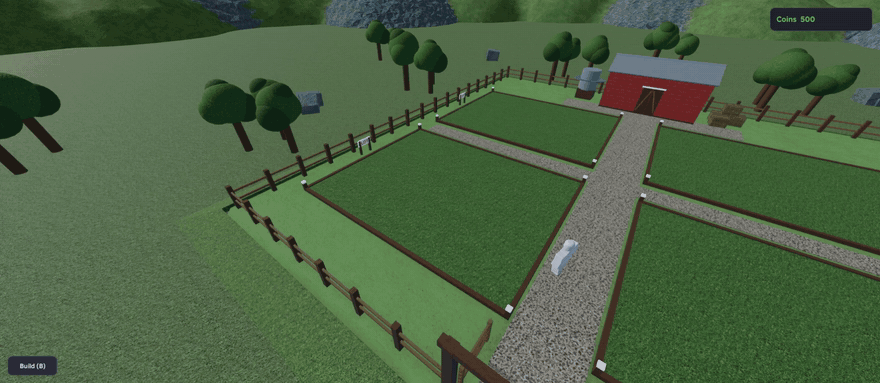
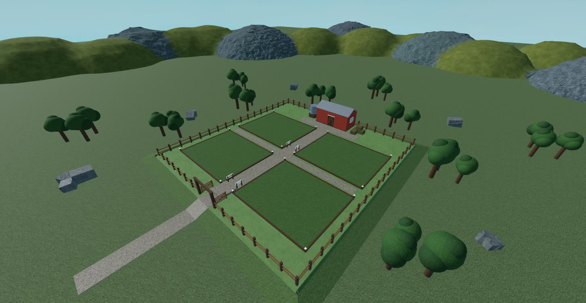
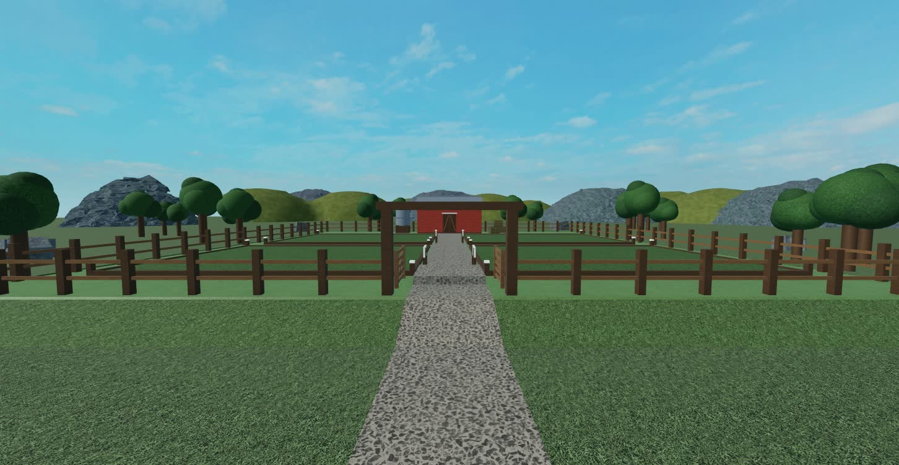
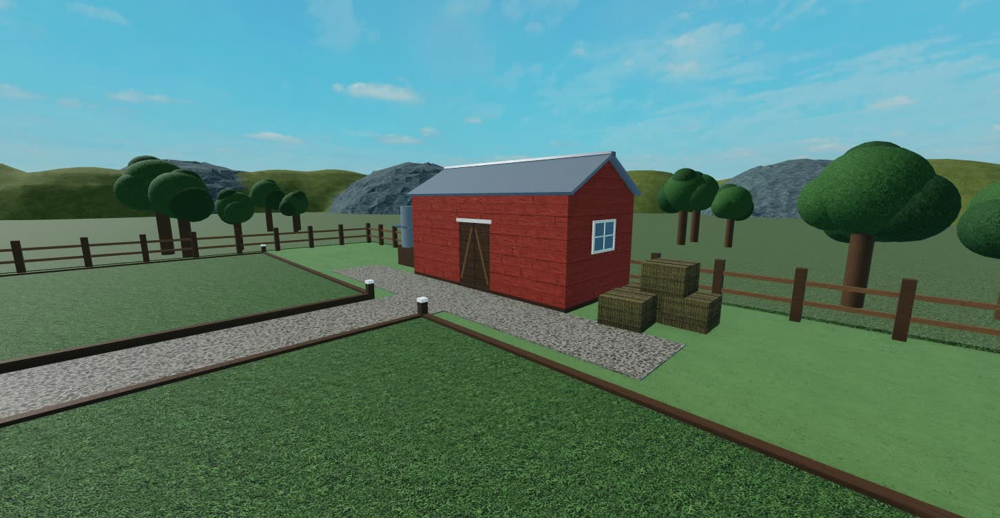
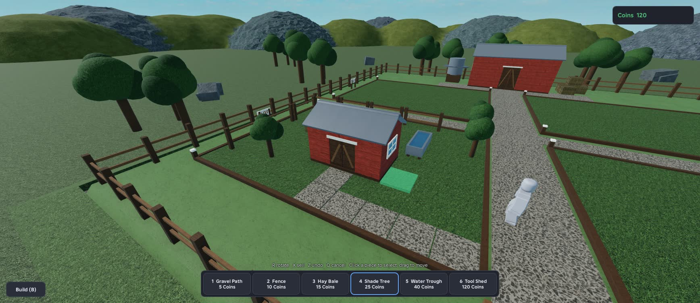

<div align="center">

# paddock

Plot claiming, grid placement and saved layouts for Roblox building games, with every place, move and sell checked on the server. It leaves out item art, plot sharing and anything a player does with what they build. Player data is saved with a session lease, the same store as [satchel](https://github.com/Provokke/satchel).

    

Refer to [LICENSE](LICENSE) for the legal bits.

</div>



## What's in it

- **Plots.** A plot is a part in Workspace tagged `PaddockPlot` with a whole `PlotIndex` attribute. Its size in whole grid cells (`CellSize` studs per cell) is its build area. Every plot gets the same build area: if the plots differ in size, the server warns at start-up and uses the smallest width and the smallest depth for all of them, counted from each part's min corner. A joining player gets the lowest free plot, and it is released, with its pieces removed, when they leave. A player with no free plot can look but not build.
- **Grid placement.** A piece has a footprint in cells (`w` by `d`), a cost in Coins and a `maxCount` per plot. Rotation is in quarter turns, and odd turns swap width and depth. A place or move checks the bounds, overlap (a moved piece never collides with its own old cells) and the limit. A refused call leaves the layout exactly as it was and says why.
- **The same rules on both sides.** `Layout` and `Grid` have no Roblox types and are shared. The client colours the ghost green or red with them, and the server never trusts that colour and checks again.
- **A money path that is checked on the server.** Whole Coins only. A place checks the layout, commits the piece, then charges, and takes the piece off again if the charge is refused. A sell refunds `floor(cost × SellRefund)`. The next section has the details.
- **Undo.** Z steps back through the last `UndoDepth` actions made in the last `UndoSeconds`: a place (full refund of what was charged), a move (the piece goes back) or a sell (the piece comes back and the refund is charged again).
- **Saved layouts.** With the built-in wallet, Coins and the layout are one record, saved together with a session lease. Layouts are stored relative to the plot, and every plot has the same build area, so a player gets their paddock back on whichever plot they are given next. On load every saved entry goes back through `Layout`: unknown ids, out-of-bounds or overlapping entries and entries past `maxCount` are dropped and logged, never trusted. A dropped piece whose id is still in the catalogue is refunded at its sell value in the same load.
- **Server authority.** Clients send intent only (`place`, `move`, `sell` or `undo`). Every call is checked for type and range, rate limited per player and then checked against the rules. A call with bad arguments, over the rate limit, from a player who can't build, or sent while that player's last call is still running is dropped and counted. A call the rules refuse (it can't be afforded, it overlaps, it is past the limit) changes nothing and isn't counted. Either way nothing is sent back about why. The client learns the result from the next Sync, which carries the plot, the balance and the layout.
- **Build mode.** A hotbar of placeables with their cost, and a ghost that follows the mouse and snaps to the plot grid.

| Key | Does |
|---|---|
| B | Turns build mode on and off |
| 1 to 6, or click | Selects a piece from the hotbar (one key per piece in the shipped config) |
| R | Rotates the ghost, or the piece being dragged |
| Click | Places the selected piece |
| Click a placed piece | Selects it |
| Drag | Moves the selected piece |
| X | Sells the selected piece |
| Z | Undoes the last action |
| Q | Cancels a drag, then deselects |

```lua
-- src/shared/Config.luau
Placeables = table.freeze({
	trough = table.freeze({
		name = "Water Trough",
		w = 2,
		d = 1,
		cost = 40,
		maxCount = 6,
		colour = { 110, 140, 170 },
	}),
}),
```

## The money path

Every place, move, sell and undo moves Coins through `Build.luau`, and nothing in it yields on its own. The one other payment is the restore refund on load (below), which `init.server.luau` credits once and logs if the wallet refuses it.

- **Whole Coins, server-priced.** The client sends an item id and a cell, never a price. The cost comes from `Config.Placeables`, and the wallet refuses anything that isn't a whole number in range (no NaN, no fractions, nothing past 2^53) and leaves the balance alone when it refuses.
- **Place: check, commit, charge.** The layout is checked first (`canPlace`), then the piece is committed, then the wallet is charged. If the charge is refused, or the wallet throws, the piece comes off again, so nothing stays placed that wasn't paid for. While its charge is running the piece is pending, and nothing can sell, move or undo it.
- **Sell and undo: state first, wallet second.** The piece (or the history entry) is removed, or an undone sale's piece put back, before the wallet is called, and the change is reversed if the wallet refuses. A wallet that yields can't pay a second sell or a second undo of the same thing, because the second call finds nothing left to act on. A second sell of the same `uid` is refused with no credit.
- **Wallets that yield.** A wallet, or its `onChange`, may yield. Every change to the layout is written into the session data before the wallet is called, so a save made during the wait already holds the new layout. The built-in `Wallet` writes the balance before its `onChange` runs, so with it that save holds the whole action: after a sell, 440 Coins and no shed, never 440 Coins and the shed. While one call from a player is waiting, any other call from them is dropped. A leave or a shutdown waits for that call to finish, for up to `CloseTimeoutSeconds` (25), before the session is saved and released.
- **Sell** refunds `floor(cost × SellRefund)`, 0.5 by default. A move costs nothing and charges nothing.
- **Undo** covers the last `UndoDepth` (10) actions that are at most `UndoSeconds` (30) old. Undoing a place removes the piece and refunds what was actually charged. Undoing a move puts the piece back where it was. Undoing a sell puts the piece back under its old uid and charges what the sell paid. The amounts are the ones stored with the action, never a fresh catalogue price, so a price change can't mint or burn Coins. An undo is refused, with the balance and layout untouched, if the cells are now taken, the limit has been reached, the piece is already gone, or the player can't pay. An undo is never itself undoable.

### Using your own wallet

`Build` takes any table that matches `WalletLike`. The built-in `Wallet` keeps Coins in the player's own saved data. To charge a ledger you already have, pass something with the same three functions. The one line to change is `local wallet = Wallet.new(session.data)` in `onSessionReady`, at `src/server/init.server.luau:308`. That wallet is what Build charges, what pays the restore refund, and what Sync reads the balance from, so the HUD and the client's can-I-afford-it check show the ledger's Coins. This one sits over a [tuckshop](https://github.com/Provokke/tuckshop) `Ledger`:

```lua
-- Build gets this in place of Wallet.new(session.data)
local LOG_LENGTH = 25 -- how many entries the ledger keeps

local function ledgerWallet(wallet: Ledger.Wallet, now: () -> number)
	return {
		balance = function(_self)
			return Ledger.balance(wallet, "Coins")
		end,
		charge = function(_self, amount: number, reason: string): boolean
			return amount == 0 or (Ledger.apply(wallet, "Coins", -amount, reason, now(), LOG_LENGTH))
		end,
		credit = function(_self, amount: number, reason: string): boolean
			return amount == 0 or (Ledger.apply(wallet, "Coins", amount, reason, now(), LOG_LENGTH))
		end,
	}
end
```

The `amount == 0` guard matters: `Ledger.apply` refuses a zero delta as `bad_delta`, and a sell can floor to 0. A wallet must return true when it took (or paid) the whole amount and false when it changed nothing. If a wallet throws, the call stops there and the server logs one line with the player, the action and the error. A charge that throws takes its piece back off, so a broken wallet can't leave a piece that wasn't paid for. A credit that throws leaves the piece sold and maybe unpaid, so watch for that line. A refused credit whose piece can't be put back raises the same way. The built-in profile still starts a new player with `StartingCoins`, so seed your ledger from your own starting balance and don't rely on that.

**A ledger in another record gives up the one-record guarantee.** With the built-in wallet, Coins and the layout are saved in the same DataStore record, so a save holds both or neither. A ledger saved in a different record (tuckshop's profile, say) is written separately from paddock's layout, and a server that stops between the two saves can mint or lose Coins: a sale saved in the ledger but not in the layout brings the piece back with the Coins kept. A restore refund is credited to the ledger again on each load until paddock's save of the cleaned layout lands. Keep the paddock layout in the same record as the ledger: either keep the ledger inside paddock's profile (`session.data`), or point `writeLayout` and the restore in `onSessionReady`, which both use `session.data.layout`, at the ledger's profile instead, and save both from that one record.

## 🎮 Demo place

`demo/paddock.rbxl` is a ready-made place: a fenced paddock on a raised meadow, with four plots either side of a gravel lane and a working shed in the yard. Open it in Studio and press Play. You get plot 1 and 500 Coins, the pieces are small farm models (fence, hay bale, water trough, shade tree, gravel path, tool shed), and B opens build mode. Every shot here comes from that place, the last one from a Studio play test.

| The paddock | The gate |
|---|---|
|  |  |
| **The yard** | **A plot being built on** |
|  |  |

Coming back after a rejoin isn't shown here: an in-memory store forgets everything when the play test stops. The server spec covers it instead, with a piece placed, the server restarted and the piece back on the player's plot.

## 🏗️ Architecture

```
                     Player joins / leaves / autosave / shutdown
                                   |
                                   v
 init.server.luau  ------->  Sessions  ---->  Store  ---->  Lease (claim / refresh / release)
 (services, remotes,                            |    ---->  Migrations + Steps
  plots, models)                                |    ---->  Profile (coins, layout)
        |                                       v
        |                                  DataStore  (MemoryStore in Studio)
        |
        |  Request (RemoteEvent)           Sync (RemoteEvent)
        |  <---------------------------    --------------------------->
        v                                                            client
   Handlers  -- Validate, RateLimiter ---> Build ---> Layout (rules), Wallet (Coins)
        |                                   ^
        |                                Restore (on load)
        v
   Sync: plot, balance, layout
```

```
src/
  server/
    init.server.luau   services, remotes, plots, piece models, autosave and shutdown loops
    Sessions.luau      session lifecycle on one server: load, release, autosave, shutdown wait
    Plots.luau         which player holds which plot
    Build.luau         place, move, sell and undo: the money path
    Wallet.luau        the built-in Coins balance, kept in the player's saved data
    Restore.luau       replays a saved layout through Layout, drops what no longer fits, works out refunds
    Handlers.luau      validates and rate limits every client request, one at a time per player, then syncs
    Data/
      Lease.luau       claim, refresh and release transforms
      Migrations.luau  upgrades saved data one schema step at a time
      Steps.luau       the migration steps
      Profile.luau     what a new profile holds, and how it is encoded for storage
      Store.luau       loads, saves and releases sessions over a DataStore
      MemoryStore.luau in-memory stand-in with the same UpdateAsync contract, used in Studio
  shared/
    Config.luau        catalogue, costs, refunds, undo limits, timings: the one place to edit
    ConfigCheck.luau   refuses to start the server on a bad config
    Layout.luau        pieces on one plot and the rules for where they may go (pure)
    Grid.luau          cell and plot maths with no Roblox types (pure)
    RateLimiter.luau   token bucket per player
    Validate.luau      type and range checks for remote arguments
  client/
    init.client.luau   wires input, the balance count-up and Sync
    BuildMode.luau     hotbar, ghost, selection, drag and the keys
    Theme.luau         colours and small UI helpers
```

## 🚀 Quick start

```
rokit install
rojo serve
```

Or open `demo/paddock.rbxl` and press Play.

Start from an empty baseplate, connect the Rojo plugin and add a plot:

1. Add a part, give it the tag `PaddockPlot` and an attribute `PlotIndex` (a whole number, 1 or more, one per plot). Size it in whole cells: with the default `CellSize` of 4, a part 64 by 64 studs is 16 by 16 cells. A plot smaller than one cell, one that isn't a part, and a repeated `PlotIndex` are skipped with a warning in the output.
2. Press Play. You start with 500 Coins. Press B, pick a piece with 1 to 6, move the mouse over your plot and click.

Without a tagged part the server warns once and nobody can build.

Pieces are plain coloured boxes the size of their footprint until you add models. To use your own, make a folder `ReplicatedStorage.PaddockPieces` and put a Model in it named after each piece id (`fence`, `hay_bale`, `trough` and so on). The server clones it, anchors it and pivots it onto the grid. Set each model's pivot at the bottom centre of its footprint, turned so its `w` runs along the pivot's X axis and its `d` along Z (the unturned direction), because the server places it with `PivotTo` at the centre of the footprint on the plot's top face. A piece with no model keeps the box.

To change what can be built, edit `Placeables` in `Config.luau`.

In Studio the server uses an in-memory store, so nothing is saved between plays. To use the real DataStore, set the attribute `PaddockUseDataStore` to true on ServerStorage and turn on API access for the place.

## 🧪 Testing

```
lune run tests/run
```

221 tests, all passing:

- Layout (13): bounds at each edge and rotation, overlap (touching is fine), the per-item limit, a move that overlaps only its own old cells, refusals that leave the layout untouched, uids that count up and are never reused, and a sold piece restored under its old uid.
- Grid (9): footprint swaps, plot-local centres, flooring a point to its cell, turning and converting between plot and world, and the pivot a model is placed with.
- Build (29): a place charges exactly its cost, a failed place charges nothing, double spend (130 Coins buys one shed and not two, with 240 Coins it buys both), sell refunds half and floors, a second sell credits once, free moves, and every undo rule: LIFO, stored amounts not current prices, expiry at the edge, depth, and refusals when the cells are taken, the limit is reached, the Coins are spent or the piece is gone.
- Build re-entry (25): the same money rules with a wallet that yields. Selling the same uid twice, undoing twice, and two places for one balance each pay or charge once. A piece waiting on its charge can't be sold, moved or undone. The commit hook runs before every wallet call and after every rollback. A refused credit rolls a sale back, a sold piece that can't go back raises, a charge that throws takes its piece off again, and a wallet that never yields behaves the same as the control.
- Wallet (9): charges and credits, whole numbers only, refusals that change nothing, the 2^53 ceiling, a corrupt balance refusing every change, and `onChange` firing only on success.
- Restore (5): a good layout kept whole, bad entries dropped with reasons and refunded only when they were real pieces, malformed entries never refunded, the limit applied on load, and no list at all.
- Plots (5): lowest free plot first, release and reuse, no plot when all are taken, claiming twice, and owner lookups.
- Handlers (11): bad arguments dropped with no build call and no sync, range edges, the rate limit and its refill, no build for the player, a build that throws (logged once, while a rule refusal logs nothing), a call while the last one waits on the wallet (dropped and counted), undo order kept by that busy guard, and a double spend through the handler.
- Rate limiter (4): a full bucket allows exactly its capacity, time refills it, it never overfills, and forgetting a key resets only that key.
- Validate (10): integers, strings, unit vectors and set membership, including NaN, infinity, floats, wrong types and out-of-range values.
- Config checks (12): the shipped config passes, and each rule fails when broken and passes when fixed, including a piece's colour and an id longer than a client may send.
- Lease (13): new, taken, stolen and held outcomes, expiry, refresh, release, lost leases, records with no lease, a release that already landed, and no mutation of the stored record.
- Migrations (5): steps run in order, current records are unchanged, records from the future go read-only, the input is never mutated, and a missing step names the schema.
- Fake data store (4): the fake re-runs transforms on fresh copies, re-runs when the record changes between read and write, can fail after writing, and cancels on nil.
- Store (11): fresh loads, two-server lockout, stealing an expired lease, load retries, persistent failure, read-only saves and releases, double release, round trips and the encode hooks.
- Store leases (8), Store loads (8) and Store saves (5): leases that landed but errored, long release outages, loads that hand the lease back, loads called off when the player leaves, and an older autosave that can't land after a newer save.
- Memory store (2): copies on the way in and out, and the cancel-on-nil contract.
- Profile (4): starting Coins written once by the first claim, every field kept through encode and decode, and data that isn't a table or has no Coins refused.
- Sessions (9): a quick rejoin waiting for the old release, a rejoin during a slow load, loads stopping when the player leaves, shutdown within its timeout, a leave and a shutdown waiting for a build call still running (and no longer than the timeout), and read-only and lost sessions.
- Server script (19): the real `init.server.luau`, run over a small stand-in for the Roblox services it uses (`tests/fakes/FakeGame.luau`). A bad config refuses to start, a joining player gets plot 1 and 500 Coins, a place is charged, saved and shown as a model, only changed pieces are rebuilt, a piece comes back after a rejoin on a restarted server, a shed that no longer fits is refunded 60 on join, a fifth player gets no plot and keeps their saved layout, bad requests cost nothing, and a plot too small for a cell is not used. With a wallet that yields: a sell, then a leave mid-wait, saves 440 Coins and no shed; a place, then a leave mid-wait, saves the charge with the piece; an autosave and a shutdown during the wait save the whole action; and a second request in the wait is dropped. A wallet that throws is logged once, Sync shows a ledger's balance rather than the profile's, plots of mixed sizes share the smallest area with a warning, and a refused restore refund is logged.

The client script and the UI can't run under Lune. They build with Rojo and are checked in Studio. The stand-in the server script runs on models only the members it uses, but it is not Roblox: timing, replication and the real services are checked in Studio. The runner counts a test that yields and never finishes as a failure, so a hung test can't end the run with no output.

## ⚠️ Honest limits

- Saving has only been tested against a fake data store in Lune. None of it has run against a real Roblox DataStore yet, so throttling, outages and real request budgets are unproven.
- A failed save never undoes the layout or wallet change in memory, and no build action waits on a save, so a failed write can't leave a stored change the player was told failed. The layout in memory stays the truth and the next autosave or release writes it (read-only reasoning from the save paths, not tested against a failing store).
- One flat layer per plot: no stacking, no walls on walls and no terrain editing.
- No plot sharing or build permissions for friends.
- One saved layout per player.
- After a config change, pieces that no longer fit are dropped on load and refunded at sell value, not full cost. Pieces whose id was removed from the catalogue get nothing back, as they can't be priced.
- Plots are read once, when the server starts. A plot tagged or resized later is not picked up until the next server.
- Plots of different sizes all build on the smallest one's area, so on a bigger part the strips along its far edges can't be built on. Size the plots alike to use all of each.
- A player with no free plot can look but not build. Their saved layout is kept, not lost.
- Undo history is per session and isn't saved. It is gone when the player leaves.
- Sell pays the current catalogue price, not what the player paid. Undoing a place or a sell uses the stored amounts, but a plain sell after a price change pays the new price.
- Restore across a real rejoin is covered by the Lune server spec, which saves, restarts the server and loads again. In Studio the in-memory store resets on each play, so a rejoin there starts fresh unless `PaddockUseDataStore` is set.
- If the DataStore stays down for longer than the lease (3 minutes by default) after a player leaves, the release gives up and what they did since the last successful save is lost. Until the release lands or the lease runs out, a rejoin on another server is turned away.
- The Studio request budget with the real store and no API access hasn't been checked, and the Lune fake models re-runs, interleaved calls and calls that fail after writing but is not DataStore itself.
- A wallet that yields before it writes its balance (unlike the built-in one) leaves a save made during the wait holding the new layout without the new balance: a placed piece not yet charged, or a sold piece not yet paid. A leave or a shutdown waits for the call, so this only bites if an autosave lands in the wait and the server then stops without its shutdown running, or the call outlasts the 25-second wait.
- A ledger kept in a different record from the layout gives up the one-record guarantee (see "Using your own wallet").
- The UI is functional rather than finished: no gamepad support, no item art and a fixed layout.

## Licence

MIT.
